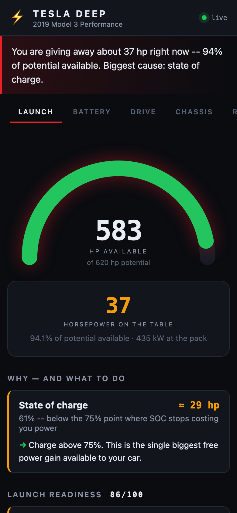

# tesla-deep

Deep CAN-bus telemetry and power analytics for a **2019 Tesla Model 3 Performance**.

Decodes **2,700 signals across 159 messages** straight off the car's vehicle bus —
individual cell-brick voltages, motor and inverter thermals, real pack capacity,
torque split, and the drive unit's own 38 power-limit reason flags that no consumer
Tesla app surfaces.

Its headline question is not "how fast is my car" but **"how much of my car can I
actually use right now, and what is in the way."**



## Run it

```bash
./run.sh                    # simulator — no hardware, works immediately
```

Open <http://localhost:8383>. On a phone, add it to the home screen — it is a PWA.

With the real car (see [docs/HARDWARE.md](docs/HARDWARE.md)):

```bash
./run.sh --source elm --port /dev/tty.OBDLink-SPP
./run.sh --source socketcan --channel can0
./run.sh --source slcan --port /dev/tty.usbmodem1234
```

## What it shows

- **LAUNCH** — horsepower available vs the car's ceiling, the hp you are giving away
  right now, *why*, and what to do about it. Live readiness score and the drive unit's
  active power limits in plain English.
- **BATTERY** — true pack capacity from `BMS_nominalFullPackEnergy` (the honest
  degradation figure, not the rated-range guess), cell-brick spread, min/max brick and
  which brick number, pack thermals.
- **DRIVE** — front/rear torque split, stator/rotor/inverter temperatures and how
  close each is to its own limit.
- **CHASSIS** — per-corner tyre pressures and temperatures, brake temperatures.
- **RAW** — every live signal on the bus, searchable.

History is logged to SQLite, including automatic launch detection, so
"is my car getting slower?" becomes answerable rather than a feeling.

## Read-only, by design

This app **never transmits on the CAN bus**. It cannot change how the car behaves, and
that is deliberate — see [docs/POWER.md](docs/POWER.md) for the honest account of what
"more power" is and is not available for a Performance-trim Model 3, and why the
biggest real gain is the 60–100 hp you are already leaving on the table.

## Caveat

Signal definitions come from [joshwardell/model3dbc](https://github.com/joshwardell/model3dbc)
— community reverse-engineering, not Tesla documentation. Values are *observed*, not
authoritative, and a firmware update can change them. Treat surprising readings with
suspicion before treating them as fact.
